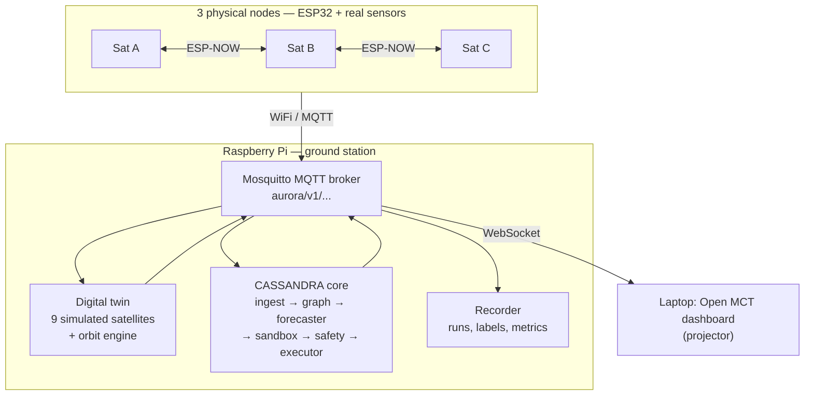

# AURORA / CASSANDRA

**Predictive, physics-aware cyber defence for satellite constellations — detecting an attack before mission failure.**

Built for IASTAM 6.0 Technical Challenge, Track 5 (Cybersecurity), Problem 10: *"Detecting an Attack Before Mission Failure."*

> **Naming.** **AURORA** is the whole project/testbed (hardware, digital twin, ground station, dashboard). **CASSANDRA** is the predictive defence system inside it, described in our Phase 2 paper. Software namespace and MQTT prefix: `aurora/`. Python package for the defence core: `cassandra/`.

## The problem

Attacks on space systems rarely begin with an obvious failure. The 2022 **Viasat KA-SAT** attack used a compromised management segment to push a wiper to tens of thousands of terminals; the chain unfolded in stages. Early signals are weak and spread across subsystems — an odd command, a small thermal drift, a slight attitude perturbation. Threshold alarms on single parameters fire late, when the physical damage is already under way.

## The idea

Existing detectors ask *"is this value abnormal right now?"*. CASSANDRA asks *"where is this attack going, and how long until the mission fails?"*, and acts before the critical point with the least disruptive response.

**Six-stage loop:**

1. **Observe** — ingest, time-align and check provenance of telemetry, commands and link status.
2. **Understand** — build a typed cyber-physical graph G_t for the current second (subsystem nodes, engineering/SPARTA/learned/inter-satellite-link edges).
3. **Forecast** — a temporal graph model outputs, per satellite, P(F < t + Δ): the probability of reaching a critical state within horizon Δ, plus the next affected subsystem.
4. **Simulate** — when risk is high, clone the digital twin and play candidate responses forward; score each with J(a).
5. **Act** — execute the best response, subject to safety gates (uncertainty gate, isolation rate limit — see `docs/CONTEXT.md` Section 2 for the anti-self-DoS rationale).
6. **Verify** — check the residual risk dropped; heal and reintegrate when stable.

Full detail — the graph formalism, response-selection objective J(a), safety gates, and SPARTA mapping — is in [`docs/CONTEXT.md`](docs/CONTEXT.md) Section 2.

## Threat scenarios

| ID | Scenario | SPARTA | Mechanism | Critical state F |
|---|---|---|---|---|
| A | Cyber-to-physical cascade | IA-0009 (trusted relationship) | Malicious telecommand or schedule via abused ground trust drives thermal, power or attitude toward failure | T_bus > T_max, or SOC < SOC_min, or attitude error > θ_max |
| B | Telemetry masking | IA-0006 (compromised hosted payload) | Forged "healthy" telemetry hides real degradation | Same as A, but hidden; detected by cross-domain inconsistency |
| C | Cross-satellite propagation | IA-0009 | A compromised node pushes malicious commands to neighbours over inter-satellite links | Critical state reached on ≥ 1 neighbour |

**Known limits, stated honestly:** CASSANDRA would not have prevented KA-SAT (a ground-segment wiper); the loop runs at ms–s cadence, so there's no µs-scale reaction; no lead time against a single destructive command with no precursor; cross-checks fail if every channel is compromised; labelled real attack data is scarce. See `docs/CONTEXT.md` Section 3.

## Architecture (Phase 3 target)

3 physical ESP32 satellites (A, B, C) link to each other over ESP-NOW and to the ground station over WiFi/MQTT. The Raspberry Pi runs the Mosquitto broker, a 9-satellite digital twin (completing a 12-satellite constellation), the CASSANDRA defence core, and the evaluation recorder. A laptop renders the NASA Open MCT dashboard over WebSocket, meant to run full-screen on a projector.

Full architecture detail — bill of materials, pin map, subsystem physics models, module responsibilities — is in [`docs/CONTEXT.md`](docs/CONTEXT.md) Section 5.

## Repository layout

| Path | Contents |
|---|---|
| `docs/` | Phase 2 paper, demo note, full project context, interface contract |
| `firmware/` | ESP32 satellite node (PlatformIO project) |
| `ground/` | Raspberry Pi setup: Mosquitto config, docker-compose, systemd, MQTT↔WS bridge |
| `twin/` | Digital twin: subsystem models, orbit/geometry engine, episode generator, sandbox API |
| `cassandra/` | Defence core: ingest, graph, monitor, forecast, sandbox client, safety, executor, verify, explain |
| `ml/` | Forecaster model, training, calibration, baselines, export |
| `eval/` | Evaluation harness, metrics, dataset loaders (SCAD, ESA-ADB, CuCD-ID), plots |
| `attacks/` | Red-team and fault library (hardware + twin) |
| `dashboard/` | Open MCT app and plugins |
| `data/` | Gitignored; download scripts + README |
| `prototype/phase2-demo/` | The working Phase 2 demo (ESP8266 firmware, PowerShell bridge, Redis services) |
| `tests/` | Shared/cross-cutting test suite |

Each folder has its own `README.md` with purpose, owner, and the interfaces it uses.

## Status

| Component | Owner | Status |
|---|---|---|
| Phase 2 demo (Scenario A, ESP8266 + Redis) | Mayssam Hergli | done (not yet imported into this repo — see `prototype/phase2-demo/README.md`) |
| Repo skeleton, README, `.gitignore` | Mayssam Hergli | done |
| `docs/interfaces.md` + `aurora_common` schemas | Mayssam Hergli | planned (Task 2) |
| Ground station bring-up (Mosquitto, docker-compose) | TBD | planned (Task 3) |
| Digital twin v0 (1 satellite, thermal + EPS) | TBD | planned (Task 4) |
| Episode generator | TBD | planned (Task 5) |
| CASSANDRA core skeleton | Mayssam Hergli | planned (Task 6) |
| Evaluation harness + dataset loaders (SCAD, CuCD-ID, OPS-SAT-AD; ESA-ADB loader not yet run) | Youssef Mhamdi (ML side; to share with the twin/evaluation owner) | done for the forecaster, simulation only (`eval/`) |
| Firmware v1 (ESP32, PlatformIO) | TBD | planned (Task 8) |
| Digital twin v1 (12 satellites, orbits, ADCS, ISL) | TBD | planned |
| Sandbox + J(a) + safety gates | Mayssam Hergli | planned |
| Learned forecaster (GNN + GRU), calibration, baselines | Youssef Mhamdi | done v1, evaluated on synthetic stand-in episodes (`ml/`); twin v1 episodes and Pi latency pending |
| Scenarios B and C end-to-end | Mayssam Hergli | planned |
| Open MCT dashboard | TBD | planned |
| Raspberry Pi deployment + latency | TBD | planned |
| Final evaluation runs + paper figures | TBD | planned |

## Getting started

### `prototype/phase2-demo/` (Phase 2 demo)

This is the only component with working, demonstrated results (see `docs/CONTEXT.md` Section 4.1 for the measured run). **However, its source files are not yet present in this repository** — only a placeholder `README.md` exists in `prototype/phase2-demo/` right now. Once imported, the demo runs as: NodeMCU/ESP8266 firmware over serial → a PowerShell bridge (`esp_link_thermal.ps1`) → Redis (Docker, inside WSL) → Python services (`predictor.py`, `monitor.py`) on WSL. See `docs/CONTEXT.md` Sections 4.1 and 10 for the exact commands and environment gotchas once the code lands.

### Everything else

**Coming soon.** `firmware/`, `ground/`, `twin/`, `cassandra/`, `ml/`, `eval/`, `attacks/`, and `dashboard/` are currently skeletons (folder + README only) per the Phase 3 build plan below. Real setup instructions will be added to each folder's `README.md` as each component is built — see Task list in `docs/CONTEXT.md` Section 12.

## Data sources

| Dataset | Use | Link | Licence |
|---|---|---|---|
| SCAD (space-cyber-anomaly-detection-dataset) | External benchmark for single-satellite forecasting and propagation order | [github.com/jwd164/space-cyber-anomaly-detection-dataset](https://github.com/jwd164/space-cyber-anomaly-detection-dataset) | CC BY 4.0 |
| ESA Anomaly Dataset / ESA-ADB | False alarms on real operational noise | [github.com/esa/anomaly-dataset](https://github.com/esa/anomaly-dataset), [github.com/kplabs-pl/ESA-ADB](https://github.com/kplabs-pl/ESA-ADB) (data on Zenodo) | See repositories |
| CuCD-ID | Command/flight-software layer (optional) | [data.mendeley.com/datasets/7n2d42pm3n/3](https://data.mendeley.com/datasets/7n2d42pm3n/3) | See dataset page |

Datasets are **never committed**; download scripts fetch them into `data/` (gitignored). See `docs/CONTEXT.md` Section 5.6.

## Team (INSAT, Tunis)

| Name | Role |
|---|---|
| Mayssam Hergli | Lead — architecture, defence core, red team |
| Youssef Mhamdi | TBD |
| Rami Troudi | TBD |
| Eya Jendoubi | TBD |
| Youssef Atig | TBD |

See `docs/CONTEXT.md` Section 8 for area ownership (most areas still TBD — to be filled in as the team divides Phase 3 work).

## Roadmap (6 → 14 October 2026)

| Day | Goals | Exit criterion |
|---|---|---|
| Tue 6 | Repo, README, skeleton, `docs/interfaces.md` frozen, parts ordered | Everyone can clone; interfaces reviewed by all owners |
| Wed 7 | Twin v0; firmware v0; core ingest + graph skeleton; SCAD loader + threshold baseline | One physical node and one twin satellite visible on the bus |
| Thu 8 | Twin v1 (12 satellites, orbits, ISL geometry, ADCS); episode generator + labels; forecaster v0 | 1 000+ labelled episodes generated |
| Fri 9 | Sandbox + J(a) + safety gates; ESP-NOW links; dashboard v0 | Quarantine physically cuts a radio link |
| Sat 10 | Forecaster v1 + calibration + ensemble; baselines; attack library on hardware | Model beats thresholds on lead time on held-out episodes |
| Sun 11 | Full integration: 3 physical + 9 twin, end-to-end Scenarios A, B, C | Full loop runs live for 30 min without crash |
| Mon 12 | Evaluation runs (twin, SCAD, ESA-ADB), Raspberry Pi latency, results into paper | Results folder + plots committed |
| Tue 13 | Rehearsal, record backup demo, freeze `main` | Two clean rehearsals in a row |
| Wed 14 | Buffer, submission | Submitted |

Full plan, including paper milestones M1–M6, in `docs/CONTEXT.md` Section 9.

## Contributing

- **Stack:** Python 3.11, type hints, `ruff` + `black`, `pytest`, configs in YAML, deterministic seeds. Firmware: PlatformIO (preferred) or Arduino IDE. Dashboard: NASA Open MCT (Node.js).
- **One feature per branch**, pull requests into `main`. Small, reviewable steps. Never force-push.
- **`docs/interfaces.md` is the contract.** If an interface must change, update the doc in the same commit and say so in the commit message.
- **Never commit data, secrets, or large binaries.** Datasets are downloaded by scripts into `data/` (gitignored).
- **Ground truth never reaches the defence.** Attack/fault labels travel on `aurora/v1/gt/...`, read only by the evaluation recorder. `cassandra/` code must never subscribe to it.
- Developer environment is Windows + WSL (Ubuntu); see `docs/CONTEXT.md` Section 10 for environment gotchas (serial/USB, driver, network, pin, and locale issues) before giving setup instructions to teammates.

Full rules in `docs/CONTEXT.md` Section 0.

## Honesty note: emulated vs. real

This is a student testbed built in 8 days, not a flight system. We are explicit, in docs, logs, and the dashboard, about what is real hardware and what is simulated:

- **Real:** 3 ESP32 satellite nodes (Phase 3) / the Phase 2 ESP8266 node, with real temperature/current/light sensors, a real resistive heater, real LEDs, and real ESP-NOW radio links that are physically enabled/disabled by CASSANDRA's responses.
- **Emulated:** the other 9 satellites in the 12-satellite constellation (digital twin, same message format as hardware, explicitly tagged `src: "twin"`); orbital mechanics and inter-satellite geometry; the SCAD dataset's FireSat reference behaviour (used qualitatively, not as ground truth for our physical rig).
- **No invented metrics.** Every number in this repo's docs, dashboard, or paper traces back to code that ran. Anything not yet built is labelled *planned*, not claimed as done.

## References

- SPARTA: Space Attack Research and Tactic Analysis, The Aerospace Corporation, [sparta.aerospace.org](https://sparta.aerospace.org)
- O. Ben Yahia et al., "Securing the satellite link segment: a secure-by-component design," arXiv:2411.12632, 2024
- Viasat, "KA-SAT network cyber attack overview," 2022; J. A. Guerrero-Saade and M. van Amerongen, "AcidRain: a modem wiper rains down on Europe," SentinelLABS, 2022
- E. Rossi et al., "Temporal graph networks for deep learning on dynamic graphs," arXiv:2006.10637, 2020
- A. Deng and B. Hooi, "Graph neural network-based anomaly detection in multivariate time series" (GDN), AAAI 2021
- C. Guo et al., "On calibration of modern neural networks," ICML 2017; B. Lakshminarayanan et al., "Deep ensembles," NeurIPS 2017
- SCAD dataset, [github.com/jwd164/space-cyber-anomaly-detection-dataset](https://github.com/jwd164/space-cyber-anomaly-detection-dataset) (CC BY 4.0)
- ESA Anomaly Dataset / ESA-ADB, [github.com/esa/anomaly-dataset](https://github.com/esa/anomaly-dataset), [github.com/kplabs-pl/ESA-ADB](https://github.com/kplabs-pl/ESA-ADB)
- CuCD-ID, Y. Fayyaz et al., *Data in Brief* 2026, [data.mendeley.com/datasets/7n2d42pm3n/3](https://data.mendeley.com/datasets/7n2d42pm3n/3)
- AegisSat satellite cybersecurity testbed (NDSS SpaceSec 2025), [github.com/texydo/satellite_security_testbed](https://github.com/texydo/satellite_security_testbed)
- MimicSat cyber-physical testbed, arXiv:2609.28228
- NASA Open MCT, [github.com/nasa/openmct](https://github.com/nasa/openmct)

Full reference list in `docs/CONTEXT.md` Section 13.

## Licence

TBD.
