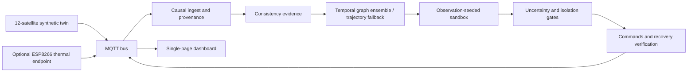

# CASSANDRA / AURORA

A research demonstrator for early warning and defensive response in a **custom synthetic 12-satellite constellation**. It combines causal telemetry/command/link processing, a temporal graph forecasting ensemble, observation-seeded response simulation, conservative safety gates, and verified recovery.



The ESP8266 endpoint emulates temperature and actuator state; it is not a physical spacecraft thermal experiment. The historical Phase-2 prototype uses Redis and serial. The integrated runtime uses MQTT. Open MCT, multi-ESP32 flight-like nodes, embedded ARM latency, and native NOS3/cFS integration remain future work.

## Reproduce

Use Python 3.11 and the pinned `requirements.lock`; `make setup` creates an isolated environment. `pip install .` also installs runtime packages and bundled YAML configuration. Run from this checkout when generating data and models.

```sh
make test lint
node --test dashboard/tests/store.test.js
make up                         # local broker, see ground/README.md
python -m ml.synthetic.generate --workers 2
python -m ml.features
python -m eval.hard_benchmark
python -m ml.train all --parallel 2
python -m eval.harness run --workers 2
python -m eval.runtime_policy --seeds 4
python -m eval.robustness --episodes 64
python -m eval.stress
python -m ml.export
python -m eval.figures
python -m eval.paper_numbers
```

Cache `test_hard` with `ml.features.build_cache('test_hard')` after generating it. OPS-SAT noise replay requires the checksummed dataset download first: `python -m eval.datasets.download opssat`. Do not mix older 27-channel checkpoints with the hardened 33-channel inputs. Old release downloads are historical and must be retrained before this runtime uses them.

## Current results

<!-- RESULTS:START -->
**Preliminary deadline-bounded run:** two trained seeds; 24 validation episodes; 20-second scoring stride. Full ablations, PGD and paired runtime campaign remain pending.

| Test | Episodes | Detected / failing satellite cases | Median detected lead | Benign-step FPR |
|---|---:|---:|---:|---:|
| ID subset | 24 | 12/12 | 117.0 s | 0.123% |
| OOD subset | 24 | 9/10 | 117.0 s | 0.052% |
| Matched hard set | 48 | 24/24 | 134.5 s | 0.093% |

These are small synthetic subsets, not full-split or flight validation. See `results/submission/metrics.json` for exact indices, thresholds, episode bootstrap intervals and comparator results. Lead resolution is up to 19 seconds. No graph-component advantage is established.
<!-- RESULTS:END -->

## Guarantees and limits

- Offline and online features share one causal event-to-frame path: no backward fill, zero initialization with explicit missingness and age.
- The same thermal, SOC and absolute-attitude limits define labels, planner crossings and safe recovery.
- `cut_heater` means heater off. It does not repair wheels or batteries. Other candidates are safe mode, an observed ISL source block, and budgeted quarantine.
- Missing or invalid uncertainty is `UNKNOWN`. Unknown/high uncertainty withholds link isolation and quarantine, permits supported local protective actions, and requests ground review.
- Mismatched source declarations are retained as low-assurance evidence and excluded from trusted observations. Source strings are not cryptographic authentication.
- A fixed forecast threshold, including 0.85, is separate from the persistence/gating/escalation/recovery policy.
- Synthetic + OPS-SAT residual noise/gaps is not flight attack validation. CuCD-ID and SCAD have separate audit/profile roles; ESA-ADB and native NOS3/cFS are not evaluated by this campaign.
- No claimed benefit of graph components is warranted unless the added ablations and harder test distinguish them. Simulation success does not establish flight readiness or physical recovery.

The correction record, evidence matrix and frozen manifest are in `docs/HARDENING_REPORT.md`, `docs/VERIFICATION_MATRIX.csv` and `results/FINAL_RUN_MANIFEST.json`. The updated research paper is `docs/paper/CASSANDRA_paper_updated.tex`; the previous technical report is preserved in `docs/historical/`.
